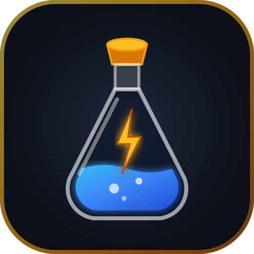

# ⚗️ Clash Potion Calculator

<p align="center">
  
</p>

<p align="center">
  <strong>The Ultimate Real-Time Boost & Upgrade Completion Calculator for Clash of Clans</strong>
</p>

<p align="center">
  <a href="https://emmanueljobcontact.github.io/coc-potion-calculator/"></a>
  <a href="https://github.com/emmanueljobcontact/coc-potion-calculator/actions"></a>
  <a href="#-license"></a>
</p>

---

**Clash Potion Calculator** is a modern, responsive Progressive Web App (PWA) designed for *Clash of Clans* players to instantly calculate exact upgrade and research completion times when using potions. Whether you're using 🛠️ **Builder Potions (10x)**, 🧪 **Research Potions (24x)**, 🐾 **Pet Potions (24x)**, ⏰ **Clock Tower Boosts**, or planning upgrades for your entire village — this tool has you covered down to the exact second.

> 🌐 **Live Web App:** [https://emmanueljobcontact.github.io/coc-potion-calculator/](https://emmanueljobcontact.github.io/coc-potion-calculator/)  
> 📱 **Mobile & PWA Ready:** Install directly to your Android or iOS home screen for offline use!

---

## 📚 Table of Contents

- [✨ Features](#-features)
- [📱 Live Web App & PWA](#-live-web-app--pwa)
- [📁 Project Structure](#-project-structure)
- [🧠 Potions Explained & Math](#-potions-explained--math)
- [🔧 Technologies Used](#-technologies-used)
- [📦 Installation & Local Setup](#-installation--local-setup)
- [🌐 Deployment](#-deployment)
- [🤝 Contributing](#-contributing)
- [📄 License](#-license)
- [⚠️ Supercell Disclaimer](#️-supercell-disclaimer)
- [☕ Support & Universal Donations](#-support--universal-donations)

---

## ✨ Features

- ⚡ **Instant Upgrade Calculator:**
  - 🛠️ **Builder Potion** (10x speed for 1 hour — completes 10 hours of work, saving 9 hours).
  - 🧪 **Research Potion** (24x speed for 1 hour — completes 24 hours of research in 1 hour).
  - 🐾 **Pet Potion** (24x speed for 1 hour in Pet House).
  - ⏰ **Clock Tower Boost** (10x speed for 30 minutes in Builder Base).
  - ⚙️ **Custom Booster** (Customize any multiplier and duration).
- ⏱️ **Dual Input Flexibility:**
  - Specify number of potions (e.g. 1, 2, 5 potions stacked).
  - Enter remaining minutes on an already active potion boost.
- 🎯 **"How Many Potions Do I Need?" (Reverse Goal Calculator):**
  - Enter upgrade time and instantly view a breakdown of potions required to finish before Clan War, CWL, or bedtime.
- 🏰 **Village Multi-Builder Planner:**
  - Track up to 6 builders + Laboratory + Pet House simultaneously.
  - See total village time saved (e.g. 1 Builder Potion saves **54 hours** across 6 builders!).
- 📆 **Real-Time Calendar Completion Clock:**
  - Shows exact real-world date and time (e.g. *"Today at 4:35:10 PM"*).
- ⏲️ **Live Countdown Timer:**
  - Real-time ticking stopwatch with Web Audio completion fanfare chime.
- 📋 **One-Click Share:**
  - Copy clean calculation summaries formatted for Discord, WhatsApp, or Clan Chat.
- 🌑 **Clash Themed UI:**
  - Responsive dark fantasy glassmorphism aesthetic inspired by Supercell's Clash of Clans.
- 📶 **Works 100% Offline (PWA):**
  - Includes a Service Worker (`sw.js`) so the calculator opens and calculates without internet.

---

## 📱 Live Web App & PWA

Access the live web application on any device:

👉 **[https://emmanueljobcontact.github.io/coc-potion-calculator/](https://emmanueljobcontact.github.io/coc-potion-calculator/)**

### How to Install on Android / Mobile:
1. Open the link above in Chrome on your phone.
2. Tap the three dots menu (**⋮**) at the top right.
3. Select **"Install app"** or **"Add to Home screen"**.
4. Launch it anytime like a native fullscreen app, even when offline!

---

## 📁 Project Structure

```
coc-potion-calculator/
├── .github/
│   ├── workflows/
│   │   └── deploy.yml        # Automated GitHub Pages CI/CD deployment
│   └── FUNDING.yml           # GitHub Sponsors & donation configuration
├── index.html                 # Main Single Page Application & layout
├── styles.css                 # Custom Clash glassmorphism styling & animations
├── app.js                     # Reactive calculation engine & DOM controller
├── calculator.js              # Standalone Node/CommonJS math engine
├── test_calculator.js         # Automated mathematical unit tests
├── manifest.json              # PWA manifest (name, colors, icons)
├── sw.js                      # Network-first offline Service Worker
├── icon.svg                   # Vector Clash potion icon
├── server.py                  # Optional lightweight Python local server
└── README.md                  # Documentation
```

---

## 🧠 Potions Explained & Math

| Potion | Multiplier | Duration | Upgrade Work Completed | Net Time Saved | Target |
| :--- | :---: | :---: | :---: | :---: | :--- |
| 🛠️ **Builder Potion** | **10x** | 1 Hour | 10 Hours | **9 Hours** per builder | All active builders & heroes |
| 🧪 **Research Potion** | **24x** | 1 Hour | 24 Hours (1 Day) | **23 Hours** | Laboratory troops & spells |
| 🐾 **Pet Potion** | **24x** | 1 Hour | 24 Hours (1 Day) | **23 Hours** | Pet House upgrades |
| ⏰ **Clock Tower Potion** | **10x** | 30 Mins | 5 Hours | **4.5 Hours** | Builder Base buildings & lab |

### Example 1: 4h 20m with Builder Potion (10x)
* **Upgrade Progress:** $4\text{ hours } 20\text{ minutes} = 260\text{ minutes}$.
* **Real Time Elapsed:** $260\text{ mins} / 10 = \mathbf{26\text{ minutes}}$.
* **Time Saved:** $4\text{h } 20\text{m} - 26\text{m} = \mathbf{3\text{ hours } 54\text{ minutes}}$.
* **Leftover Boost:** $60\text{m} - 26\text{m} = \mathbf{34\text{ minutes}}$ of 10x speed remains active for your next upgrade!

### Example 2: 4h 20m with Research Potion (24x)
* **Upgrade Progress:** $15,600\text{ seconds}$.
* **Real Time Elapsed:** $15,600\text{s} / 24 = \mathbf{650\text{ seconds (10 minutes and 50 seconds)}}$.
* **Time Saved:** $\mathbf{4\text{ hours, } 9\text{ minutes, and } 10\text{ seconds}}$.
* **Leftover Boost:** $\mathbf{49\text{ minutes and } 10\text{ seconds}}$ of 24x speed remains active in your Laboratory!

---

## 🔧 Technologies Used

- 🧩 **HTML5** – Semantic, accessible structure with responsive meta tags.
- 🎨 **Tailwind CSS + Custom CSS3** – Glassmorphism, Clash gold/elixir glows, and custom scrollbars.
- ⚙️ **Modern Vanilla JavaScript** – Zero framework bloat, reactive state updates, sub-millisecond calculation speeds.
- 🔊 **Web Audio API** – Synthesized gaming sound effects (no external audio downloads needed).
- 📱 **Progressive Web App (PWA)** – Offline caching via `sw.js` and `manifest.json`.
- 🚀 **GitHub Actions & Pages** – Automated continuous deployment on git push.

---

## 📦 Installation & Local Setup

You can run this project locally without any server dependencies:

```bash
# 1. Clone the repository
git clone https://github.com/emmanueljobcontact/coc-potion-calculator.git
cd coc-potion-calculator

# 2. Open directly in your browser
# Double-click index.html, or on Windows:
start index.html

# 3. (Optional) Run with Python local server
python server.py
```

### Running the Unit Tests:
To verify all mathematical calculations:
```bash
node test_calculator.js
```

---

## 🌐 Deployment

This project is deployed to **GitHub Pages** using GitHub Actions (`.github/workflows/deploy.yml`).

To deploy your own fork:
1. Fork or push this repository to your GitHub account.
2. Navigate to **Settings > Pages**.
3. Under **Build and deployment > Source**, select **GitHub Actions**.
4. The workflow will automatically publish your live site!

---

## 🤝 Contributing

Contributions, issues, and feature requests are welcome!

1. Fork the Project.
2. Create your Feature Branch (`git checkout -b feature/AmazingFeature`).
3. Commit your Changes (`git commit -m 'Add some AmazingFeature'`).
4. Push to the Branch (`git push origin feature/AmazingFeature`).
5. Open a Pull Request.

---

## 📄 License

Distributed under the **MIT License**. See `LICENSE` for more information.

---

## ⚠️ Supercell Disclaimer

This project is a fan-made tool and is **not affiliated with, endorsed, sponsored, or specifically approved by Supercell**. Supercell is not responsible for the operation or content of this site/application.

For more information regarding Supercell's intellectual property, please see [Supercell's Fan Content Policy](https://supercell.com/en/fan-content-policy/).

---

## ☕ Support & Universal Donations

If this calculator saved you time in *Clash of Clans* and you'd like to support continued updates, you can support via any of the universal donation options below:

| Platform | Link / Details | Accepted Globally |
| :--- | :--- | :--- |
| ☕ **Buy Me a Coffee** | [buymeacoffee.com/emmanueljob](https://buymeacoffee.com) | Cards, Apple Pay, Google Pay |
| 💖 **Ko-fi** | [ko-fi.com/emmanueljob](https://ko-fi.com) | Cards, PayPal (0% fee) |
| 🅿️ **PayPal** | [paypal.me/emmanueljob](https://paypal.me) | 200+ countries |
| 🪙 **Crypto (USDT / BTC)** | Direct borderless crypto transfer | Any country, zero restrictions |

### 🪙 Crypto Donation Wallets:
- **USDT (TRC-20):** `TYourTRC20WalletAddressHere...`
- **Bitcoin (BTC):** `bc1qYourBitcoinAddressHere...`
- **Ethereum (ETH):** `0xYourEthereumAddressHere...`

> *Thank you for keeping open-source gaming tools free and accessible for all Clashers worldwide!* 🛡️⚔️
